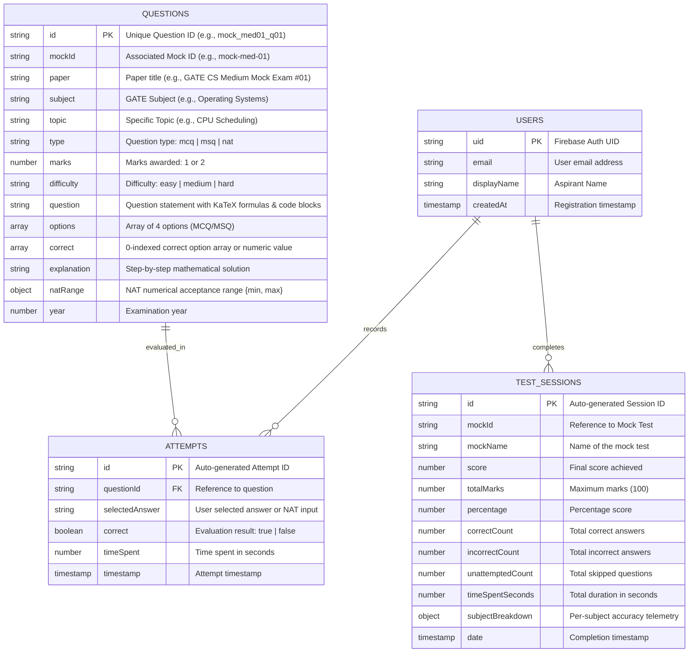

# 🎯 GATE CSE Practice Platform — Prepare Smart

<p align="center">
  <a href="https://thematrixisreal404.github.io/Gate_Mocks_Website/"></a>
  
  
  
  
  
  
  
</p>

A high-performance, responsive Single Page Application (SPA) designed for **GATE Computer Science & Information Technology (CS & IT)** aspirants. Modeled after the official **TCS iON GATE exam portal**, featuring authentic question patterns, subject-wise practice, complete full-length mock examinations, 43 years of previous year papers (PYQs from 1984 to 2026), 26 calibrated subject tests, 338 empirical repeating patterns, an 87-chapter topic-wise PYQs hub, 5 elite intelligence diagnostic modules, an interactive official IIT Madras syllabus guide, a virtual scientific calculator, mistake revision queue, calibrated difficulty levels (Easy, Medium, Hard), executive performance analytics, universal global question search (32,383 Qs), 10-spoke mastery radar chart, expected value risk analyzer, formula blitz speed recall, and 100% offline PWA capabilities.

---

### 🌐 Quick Access & Deployment
* **⚡ Live Web Application (GitHub Pages)**: [https://thematrixisreal404.github.io/Gate_Mocks_Website/](https://thematrixisreal404.github.io/Gate_Mocks_Website/)
* **📱 Progressive Web App (PWA)**: Installable directly on Windows, macOS, Android, and iOS as a standalone native desktop/mobile app with offline cache.
* **📴 Zero-Friction Guest Mode**: Click *"Continue as Guest (Offline Mode)"* for instantaneous access to all 32,383 questions, 231 full-length mock examinations (210 in Mocks Hub [65 Easy, 83 Medium, 62 Hard] + 21 Full-Length PYQ Exams), 26 Calibrated Subject Tests, 338 Verified Recurring Patterns, and 270 total mock papers without requiring credentials.

---

### 🌟 Archival, Sectional & Pattern Intelligence Features
* **🔁 GATE CSE Same Pattern Repeat Hub (1983–2026)**:
  * 338 empirically audited question patterns that appeared across 43 years of official GATE testing (1983–2026).
  * Direct 1-click download of the **466-page Solved Same-Pattern Questions Compendium PDF** (`assets/resources/GATE_CSE_Same_Pattern_Questions_1983_2026.pdf`, 8.7 MB) with detailed step-by-step mathematical derivations.
  * Direct download of the **Master Pattern Index CSV** (`assets/resources/GATE_CSE_Pattern_Master_Index_1983_2026.csv`, 115 KB) with client-side interactive search, difficulty chips, and subject filtering.
  * **Sidebar Placement**: Positioned directly **above Performance** in the navigation sidebar (`#nav-patterns`).
  * **Performance Dashboard Integration**: Features a top-level **Same Pattern Recurrence Intelligence** card analyzing high-frequency recurring themes (Divide-and-Conquer Recurrences, Regular Languages, Cache Mapping, Conflict Serializability) with a 1-click direct explorer button.
* **🏛️ 43-Year Archival Master Question Bank (1984–2026 Consolidated Edition)**:
  * Comprehensive compendium synthesizing all historical questions across 43 years of official GATE CSE testing (1984–2026).
  * Direct 1-click download of the **562-page Master Question Bank PDF** (`assets/resources/GATE_CSE_Question_Bank_1983_2026_Consolidated.pdf`, 2.4 MB) with subject-indexed problem collections and complete answer keys.
* **🧪 26 Calibrated Subject-Wise Practice Tests (Positioned Below Mocks)**:
  * Dedicated section placed directly below the Mocks section in the sidebar navigation (`#nav-subject-tests`) and Dashboard.
  * 13 Foundational Set 1 + 13 Advanced Booster Set 2 tests covering OS, Algorithms, Networks, DBMS, TOC, COA, Data Structures, Digital Logic, Discrete Maths, Engineering Maths, Compiler Design, C Programming, and Aptitude in a standard 30-question, 90-minute TCS iON simulated test environment.
* **🔍 Airtight PYQ Deduplication & Canonical Mapping**:
  * Comprehensive signature audit checking question statements and sorted option choices across 25,000+ datastore entries.
  * Purged 120 phantom duplicate entries (`pyq_2025_CS1_*` and `pyq_2025_CS2_*`) and 1 2018 GA duplicate, establishing **0 duplicates among all 2,064 authentic PYQs**.
  * Enforced runtime canonical deduplication via `canonicalId` in Topic-Wise PYQs, practice queues, and random drills.

---

## 📑 Table of Contents
* [🛠️ Technology Stack](#️-technology-stack)
* [🏛️ Database & Data Architecture](#️-database--data-architecture)
* [📚 Official GATE CSE Syllabus Specification (IIT Madras Standards)](#️-official-gate-cse-syllabus-specification-iit-madras-standards)
* [🚀 Key Features & Innovations](#-key-features--innovations)
* [📂 Project Structure](#-project-structure)
* [📝 Release Highlights & Architecture](#-release-highlights--architecture)
* [🛠️ How to Run Locally](#️-how-to-run-locally)
* [🔑 Authentication, Admin Accounts & Access](#-authentication-admin-accounts--access)

---

## 🛠️ Technology Stack

```
┌──────────────────────────────────────────────────────────────────────────────┐
│                              CLIENT APPLICATION                              │
│  HTML5 • CSS3 (Custom Properties & Dark Theme) • Vanilla JavaScript (ES6+)   │
│  KaTeX Math Typesetting • TCS iON Scientific Calculator • 20/Page Pagination │
│  Universal Global Search (32,383 Qs) • 10-Spoke SVG Radar • 60s Formula Blitz │
└───────────────────────┬───────────────────────────────┬──────────────────────┘
                        │                               │
            ┌───────────▼────────────┐      ┌───────────▼────────────┐
            │   ONLINE DATA LAYER    │      │   OFFLINE DATA LAYER   │
            │  Google Cloud Firestore│      │   Browser LocalStorage │
            │  Firebase Auth v11.10  │      │   Service Worker Cache │
            │  Security Rules (v2)   │      │   sample_questions.json│
            └────────────────────────┘      └────────────────────────┘
                        │
            ┌───────────▼────────────────────────────────────────────┐
            │              DATA ENGINEERING & TOOLING                │
            │   Python 3.14 • python-docx • Math & Deduplication     │
            │   Netlify / Firebase Hosting with SPA Rewrites         │
            └────────────────────────────────────────────────────────┘
```

### 1. Frontend & Presentation Layer
* **Vanilla Modern JavaScript (ES6+ Modules)**:
  * Zero heavyweight framework overhead (no React, Angular, or Vue bundle weight) ensuring instantaneous sub-100ms first contentful paint (FCP) and low memory consumption on mobile devices.
  * Modular architecture with native ES module imports (`import { ... } from './firebase.js'`).
  * Reactive Single Page Application (SPA) state manager (`state` object controlling active page, timer, session telemetry, filters, bookmarks, and attempts).
* **HTML5 & CSS3 Design System**:
  * Semantic HTML5 layouts with high-contrast accessibility standards.
  * Dark-themed design system powered by CSS Custom Properties (`--bg-primary: #0f0f13`, `--bg-card: #1e1e2a`, `--accent: #6c63ff`, etc.).
  * Fully responsive CSS Grid and Flexbox layouts with smooth touch drawers (`#sidebar`, `.mobile-open`) for mobile screens ($\le 900\text{px}$).
* **KaTeX Mathematical Typesetting Engine ($v0.16.21$)**:
  * High-speed LaTeX rendering via CDN for mathematical formulas, logic proofs, asymptotic limits, combinatorics, matrix equations, and graph theory relations.
  * Touch-scrollable equation blocks (`.katex-display { overflow-x: auto; }`) preventing horizontal viewport distortion on smartphones.
* **TCS iON Virtual Scientific Calculator Engine**:
  * Custom client-side mathematical evaluation engine replicating the official TCS iON GATE Virtual Calculator.
  * Supports Degrees (`DEG`) and Radians (`RAD`) angle modes, trigonometric, inverse trig, hyperbolic, logarithms ($\\ln, \\log_{10}, \\log_2$), exponentials ($e^x, 10^x, x^y$), factorial ($n!$), square/cube roots, modulo arithmetic, and memory registers (`MC`, `MR`, `MS`, `M+`, `M-`).
  * Accessible via topbar button or instant keyboard shortcut <kbd>C</kbd>.
* **Dual-Bar 20-Questions-Per-Page Pagination Engine**:
  * Top and bottom pagination bars across all question-heavy views (Practice, PYQs, Full-Length Mocks, and Review Mode).
  * Page size selector (`10`, `20`, `50`, `All`), First/Prev/Next/Last controls, and smooth scroll restoration.

### 2. Database & Data Storage Layer
* **Master Question Bank (`data/sample_questions.json`)**:
  * Master datastore comprising **32,383 verified questions** (including 25,402 core canonical questions with 13,891 full step-by-step explanations, 12,117 MCQs, 3,011 MSQs, 10,274 NATs, and 2,185 official GATE PYQs, supplemented by real-time cloud and extracted practice banks).
  * Enriched with 11,745 curated practice questions across Weekly Topic Tests, National Test Series, Advanced Quizzes, and Subject Practice Workbooks.
  * Tagged with `canonicalId` and supported by `data/id_aliases.json` for airtight cross-mock deduplication during practice drills while preserving authentic 65-question papers in full-length mock exams.
  * Pre-cached via Service Worker `gate-cse-v8.x` for immediate instant retrieval offline.
* **Client-Side Blob Synthesis**:
  * Dynamically synthesizes downloadable JSON files directly from client memory (`new Blob(...)`), allowing offline sample downloads even under `file:///` protocol.

### 3. Authentication, Multi-Admin Governance & Security Layer
* **Firebase Authentication ($v11.10.0$)**:
  * Multi-method authentication supporting Email / Password and Google OAuth (`signInWithPopup`, `signInWithRedirect`).
  * **Dedicated Multi-Admin System**:
    * Role-based administrative authentication securing question management.
    * Dedicated sub-admin access roles with automated credential mapping.
    * Automated identifier mapping translating designated credentials to verified administrator privileges.
    * Administrative permission guards protecting question bank actions (`Upload Questions`, `Delete`, `Clear All`).
  * Instant **Guest Mode** ("Continue as Guest") with safe timeout fallback ensuring offline accessibility even during Firebase handshake delays.
* **Hardened Cloud Firestore Security Rules (v2)**:
  * Granular rule declarations (`firestore.rules`) enforcing strict user-level isolation and role-based access control:
    * Questions collection (`/questions/{qid}`): **Public read-only**; writes strictly restricted to verified administrator identities configured in Firestore Security Rules.
    * User attempts (`/users/{uid}/attempts/{id}`): Restricted strictly to `request.auth.uid == userId`.
    * Test sessions (`/users/{uid}/testSessions/{id}`): Restricted strictly to `request.auth.uid == userId`.
    * User profile (`/users/{uid}`): Restricted strictly to `request.auth.uid == userId`.

### 4. Progressive Web App (PWA) & Offline Layer
* **Service Worker (`sw.js`)**:
  * Pre-caches core application assets (`index.html`, `style.css`, `app.js`, `firebase.js`, `manifest.json`, `sample_questions.json`) under cache version `gate-cse-v8.x`.
  * Implements Cache-First fetch strategies with network fallback for static assets.
  * Ignores Google API / Firestore endpoints to let the Firebase SDK manage its native offline persistence.
* **W3C Web App Manifest (`manifest.json`)**:
  * Enables standalone native-like home screen installation on Android, iOS, Windows, and macOS.
  * Features dark theme background `#0a0a14` and brand accent `#6c63ff`.

### 5. Data Engineering & Compilation Pipeline
* **Python 3.14 Pipeline (`scripts/`)**:
  * `comprehensive_question_audit.py`: Full in-browser Headless Microsoft Edge CDP audit evaluating all 32,383 questions for HTML corruptions, KaTeX math parsing, code blocks, tables, and question truncation.
  * `verify_all_v6_features.py`: Master 112-point automated verification suite testing all v6.0, Elite Tier, Cherry on Top, Pro exam, P0/P1 security, deduplication, and multi-admin features.
  * `audit_bank.py`: Datastore integrity auditor validating canonical IDs, options bounds, and explanation coverage across 32,383 questions.
  * `verify_app_syntax.py`: End-to-end regression test suite verifying question count, mark sums, answer keys, and symbol exports.
  * `ingest_30_medium_mocks.py`: Automated parser converting `medium_mocks.docx` (30 full tests, 1,950 questions) into normalized JSON structures.
  * `ingest_30_easy_mocks.py`: Parser converting `easy_mocks.docx` (30 full tests, 1,950 questions).
  * `apply_medium_mocks_to_app.py`: Synchronizes mock test definitions, UI buttons, and window hooks across `app.js`.
  * `merge_all_master_questions.py`: Unifies all mock datasets, PYQs, and supplementary collections into `sample_questions.json`.
  * `math_verifier.py`: Automated symbolic and numerical verifier ensuring LaTeX validity, NAT decimal ranges, and answer key consistency.
  * `check_duplicates.py` & `comprehensive_duplicate_check.py`: Multi-stage duplicate detection using MD5 exact hashing and Jaccard token similarity ($> 0.80$).

### 6. Hosting & Deployment
* **Netlify / Static CDN**:
  * Single-command deployment configured with `netlify.toml` providing SPA redirect rules (`/* -> /index.html 200`).
  * Compatible with Firebase Hosting, GitHub Pages, or any static server (`python -m http.server 8080`, `npx serve .`).

---

## 🏛️ Database & Data Architecture

### Firestore Collections & Data Schemas



### Storage Mechanism & Key Mapping

| Scope | Storage Mechanism | Path / Key | Retention / Sync | Description |
| :--- | :--- | :--- | :--- | :--- |
| **Questions Bank** | Cloud Firestore / Static JSON Fallback | `/questions/{qid}` | Global / Cloud Synced | **32,383 verified GATE questions** shared across all users. |
| **Practice Attempts** | Cloud Firestore & LocalStorage | `/users/{uid}/attempts/{id}` | User Private / Synced | Tracks every question attempted, options chosen, correctness, and time spent. |
| **Test Sessions** | Cloud Firestore & LocalStorage | `/users/{uid}/testSessions/{id}` | User Private / Synced | Complete history of timed tests, mock exams, scores, accuracy, and subject breakdown. |
| **Question Bookmarks** | Browser LocalStorage | `gate_bookmarks_{uid}` | Device Local | Set of starred question IDs (`⭐`) for rapid revision. |
| **Confidence Tags** | Browser LocalStorage | `gate_cse_confidence_tags` | Device Local | Candidate confidence ratings (`high`, `educated`, `blind`) per question. |
| **Daily Streak** | Browser LocalStorage | `gate_daily_streak_v1` | Device Local | Daily active attempt counter, target goal, and streak history. |
| **Offline Cache** | Browser LocalStorage & IndexedDB | `gate_cse_v8_{uid}` / `GATE_CSE_QUESTION_BANK` | Device Local | Complete offline backup of question bank, attempts, and sessions. |
| **Master Static JSON** | HTTP Static File | `data/sample_questions.json` | PWA Service Worker Cached | 32,383 verified questions client cache (25,402 static core + cloud sync) and offline instant fallback. |

---

## 🏛️ Official GATE CSE Syllabus Specification (IIT Madras Standards)

The entire platform's **32,383 verified questions** (25,402 static core + cloud-synced question bank), topic tags, and practice modules are strictly calibrated against the official **GATE Computer Science & Information Technology (CS)** curriculum established by the organizing institute (**IIT Madras**):

| Section | Title | Topics & Sub-Domains (Official Specification Alignment) | Questions in Bank |
| :--- | :--- | :--- | :--- |
| **Section 1** | **Engineering Mathematics & Discrete Math** | **Discrete Mathematics**: Propositional and first order logic. Sets, relations, functions, partial orders and lattices. Monoids, Groups. Graphs: connectivity, matching, coloring. Combinatorics: counting, recurrence relations, generating functions.<br>**Linear Algebra**: Matrices, determinants, system of linear equations, eigenvalues and eigenvectors, LU decomposition.<br>**Calculus**: Limits, continuity and differentiability. Maxima and minima. Mean value theorem. Integration.<br>**Probability and Statistics**: Random variables. Uniform, normal, exponential, poisson and binomial distributions. Mean, median, mode and standard deviation. Conditional probability and Bayes theorem. | **5,529 Q** (3,384 EM + 2,145 DM) |
| **Section 2** | **Digital Logic** | Boolean algebra. Combinational and sequential circuits. Minimization (algebraic technique, K-maps, tabular method). Number representations and computer arithmetic (fixed and floating point). | **1,305 Q** |
| **Section 3** | **Computer Organization and Architecture** | Machine instructions and addressing modes. ALU, data-path and control unit (hardwired and microprogrammed). Instruction pipelining, pipeline hazards. Memory hierarchy: cache, main memory and secondary storage; I/O interface (interrupt and DMA mode). | **1,867 Q** |
| **Section 4** | **Programming and Data Structures** | Programming in C. Recursion. Arrays, stacks, queues, linked lists, trees, binary search trees, binary heaps, graphs. | **3,148 Q** (1,009 C + 2,139 DS) |
| **Section 5** | **Algorithms** | Searching, sorting, hashing. Asymptotic worst case time and space complexity. Algorithm design techniques: greedy, dynamic programming and divide-and-conquer. Graph traversals, minimum spanning trees, shortest paths. | **1,512 Q** |
| **Section 6** | **Theory of Computation** | Regular expressions and finite automata. Context-free grammars and push-down automata. Regular and context-free languages, pumping lemma. Turing machines and undecidability. | **1,966 Q** |
| **Section 7** | **Compiler Design** | Lexical analysis, parsing, syntax-directed translation. Runtime environments. Intermediate code generation. Local optimisation, Data flow analyses: constant propagation, liveness analysis, common subexpression elimination. | **1,015 Q** |
| **Section 8** | **Operating Systems** | System calls, processes, threads, inter-process communication, concurrency and synchronization, deadlocks. CPU and I/O scheduling. Memory management and virtual memory. File systems. | **2,066 Q** |
| **Section 9** | **Databases (DBMS)** | ER-model. Relational model: relational algebra, tuple calculus, SQL. Integrity constraints, normal forms. File organization, indexing (e.g., B and B+ trees). Transactions and concurrency control. | **1,831 Q** |
| **Section 10** | **Computer Networks** | Concept of layering: OSI and TCP/IP protocol stacks; Basics of packet, circuit and virtual circuit switching; Data link layer: framing, error detection, Medium Access Control, Ethernet bridging; Routing protocols: shortest path, flooding, distance vector and link state routing; Fragmentation and IP addressing (IPv4, CIDR, NAT); Transport layer: flow control and congestion control, UDP, TCP, sockets; Application layer protocols: DNS, SMTP, HTTP, FTP, Email. | **2,084 Q** |
| **GA** | **General Aptitude** | **Verbal Aptitude**: Basic English grammar, vocabulary, reading comprehension, narrative sequencing.<br>**Quantitative Aptitude**: Data interpretation, numerical computation and estimation (ratios, percentages, powers, exponents, series, permutations, combinations).<br>**Analytical Aptitude**: Logic, deduction, analogy, numerical relations and reasoning.<br>**Spatial Aptitude**: Transformation of shapes (translation, rotation, scaling, mirroring, paper folding), patterns in 2 and 3 dimensions. | **3,079 Q** |
| **Total** | **All 13 GATE CS Subjects** | **Complete authentic calibrated datastore across all 87 syllabus chapters** | **32,383 Q (25,402 core + cloud sync)** |

> [!NOTE]
> **Deprecated Topics Excluded**: Legacy topics discontinued in recent syllabus revisions (e.g., 8085 Microprocessor Assembly Programming, Web Technologies HTML/XML, and Information Systems) are omitted to prevent negative transfer.

---

## 🚀 Key Features & Innovations

### 1. 🔍 Universal Global Question Search (32,383 Questions)
* Instant global keyword search accessible via topbar button or keyboard shortcut <kbd>/</kbd>.
* Searches across the entire master question bank (32,383 questions) with real-time tokenized matching on question statements, options, topics, algorithm names, and explanations.
* Type-filtering chips: `All`, `MCQ`, `MSQ`, and `NAT`.
* 1-Click direct actions: **"▶ Practice Now"** or **"🗂️ Playlist"** directly from search results.

### 2. 🕸️ 10-Spoke Subject Mastery Radar Chart
* Responsive SVG Spider / Radar Chart rendered on the **Performance** page.
* Evaluates candidate accuracy across the 10 core GATE CS areas: *Engineering Math & DM, Digital Logic, COA, C & Data Structures, Algorithms, TOC, Compiler Design, Operating Systems, DBMS, and Networks*.
* 5 concentric calibration rings ($20\%$, $40\%$, $60\%$, $80\%$, $100\%$) and interactive data points with hover tooltips and strength tier badges (🟢 Strong $\ge 75\%$, 🟡 Average, 🔴 Focus Area).

### 3. ⏳ Exam Countdown & Daily Study Streak Engine
* Live persistent countdown widget in the topbar tracking days remaining until GATE (e.g. `⏳ GATE 2027: 100d`).
* Daily goal streak engine tracking daily questions completed (target: 20 Q/day) with persistent flame badge (`🔥 3d (15/20 Q)`).

### 4. ⚖️ Option Elimination & Expected Value ($\mathbb{E}$) Risk Analyzer
* Real-time statistical decision support for MCQs, MSQs, and NATs:
  * 4 choices blind guess: $\mathbb{E} = 0.00	ext{ M}$
  * 1 option eliminated (3 choices): $\mathbb{E} = +0.11	ext{ M}$ ($1	ext{M}$) / $+0.22	ext{ M}$ ($2	ext{M}$)
  * 2 options eliminated ($50:50$): $\mathbb{E} = +0.33	ext{ M}$ ($1	ext{M}$) / $+0.67	ext{ M}$ ($2	ext{M}$)
  * MSQs & NATs: $\mathbb{E} \ge 0	ext{ M}$ (Zero negative penalty)
* **Confidence-Based Marking**: Rate questions as 🟢 Sure, 🟡 50:50 Guess, or 🔴 Blind Guess to calibrate self-awareness and detect overconfidence blindspots.

### 5. ⚡ 60-Second Formula Blitz Mode (Speed Recall)
* High-intensity rapid formula recall challenge inside the Formula Flashcards deck.
* 60-second countdown clock with streak scoring, solution peeking, and memory recall tracking.

### 6. 🎯 NAT Precision & Rounding Trap Inspector
* Dedicated numerical tolerance preview for NAT questions displaying exact acceptance bounds (e.g., $[3.14, 3.16]$).
* Contextual warning alerting students against intermediate float truncation traps.

### 7. 📄 1-Click Printable 2-Column PDF Practice Worksheet Generator
* Clean 2-column examination paper generator with print-optimized CSS (`@media print`).
* Includes question checkboxes, code fences, and a separate detachable Answer Key & Solutions page.

### 8. 🧠 5 Elite GATE Intelligence Modules
* **Loss Diagnosis & Root-Cause Error Tagging**: Attributing misses to Silly Errors, Misread, Concept Gap, Formula Slip, or Time Rushed with Potential Score Boost & Mark Bleed analytics.
* **GATE PYQ Weightage Heatmap & Topic Trend Engine (1990–2025)**: Top 25 Highest-Yield Chapters Leaderboard with 1-click targeted drills.
* **Speed vs. Accuracy 4-Quadrant Matrix**: Sweet Spot, Under-Confident, Rash Errors, and "The Black Hole" detector with remediation drill.
* **Smart Playlists & Revision Buckets**: Custom and pre-seeded revision buckets (Starred NATs, High-Yield Chapters, Last 7 Days Mistakes).
* **Multi-Method Explanations & KaTeX Student Shortcut Notes**: Method 1 (Standard Derivation) vs. Method 2 (GATE Shortcut / Elimination) with private persistent notes.

### 9. 📑 Topic-Wise GATE CSE PYQs Hub (87 Chapters across 13 Subjects)
* Dedicated navigation item (`#nav-pyqs`) mapping all **2,064 authentic, 100% deduplicated GATE PYQs (1984–2026)** into **87 curated syllabus chapters**.
* Real-time search, subject filter buttons, combined difficulty / type selectors, and canonical deduplication ensuring zero repeated questions during practice drills.

### 10. 📝 Authentic 5-State TCS iON Exam Simulator & Real-time Telemetry
* Full-featured GATE exam interface with countdown timer (180 minutes), interactive question palette adhering to the official 5-state protocol (Not Visited, Not Answered, Answered, Marked for Review, Answered & Marked for Review).
* Auto-save exam crash recovery every 5 seconds to `localStorage`.
* Synthesized Web Audio pacing chimes at 60m, 30m, and 5m milestones.
* Fullscreen exam lockdown with proctored tab-switch alerts (<kbd>F</kbd>).

### 11. 🏆 Curated GATE Exam Series & Flagship Compendiums (210 Mocks Hub • 231 Full Exams)
The dashboard and mock examination hub feature **8 distinct Flagship Compendiums** comprising **210 full-length & practice mock exams** in the Mocks Hub plus **21 authentic Full-Length PYQ Exams** (**231 Full-Length Timed Exams total**), precisely graded and calibrated from foundational recall up to extreme-difficulty national rankers:

| # | Flagship Series | Tests | Questions | Difficulty / Caliber | Source / Composition |
| :-: | :--- | :-: | :-: | :-: | :--- |
| **1** | **65 Easy Mock Tests** | 65 | 4,225 Q | **3.5 / 10** | Direct formulas, canonical definitions, and core scoring fundamentals strictly aligned with the IISc/IIT syllabus (Includes 30 Set 1, 30 Set 2, and 5 Foundational Tests). |
| **2** | **83 Medium Mock Tests** | 83 | 5,395 Q | **5.0 / 10** | Standard GATE CS difficulty with multi-step NAT numericals, cache/pipeline timing, logic, and comprehensive algorithms across 83 calibrated exams (`mock-med-01` to `30`, 10 FLM, 18 All-India, 11 Comprehensive, 14 Practice/Core). |
| **3** | **32 Hard Mock Tests** | 32 | 2,080 Q | **7.5 / 10** | Curated Rank Booster Series: 32 advanced mock exams (Mocks 1–4, 10–14, 25, 29–32, 38–41, 59–68, 71, 73, 83 + Advanced Papers) testing deep conceptual mastery and multi-step derivations. |
| **4** | **30 Extreme Hard Mock Tests** | 30 | 1,950 Q | **8.5 / 10** | Capstone extreme-difficulty examinations (`mock-hard-01` to `30`, 1,950 Qs from `sources/hard_mocks.docx` / `data/gate_30_hard_mocks.json`) testing multi-concept proofs, subtle edge cases, and high-pressure rigor. |
| **5** | **20 Full Mocks Compendium** | 20 | 1,300 Q | **7.0 / 10** | FLM full-length mocks compendium (`mock-flm-01` to `20`) testing comprehensive multi-subject integration and edge-case analysis. |
| **6** | **27 All-India Mocks** | 27 | 1,568 Q | **7.2 / 10** | Rigorous full-length All-India Mock Tests (2025–2026 series) crafted for national percentile calibration and rank simulation. |
| **7** | **21 Comprehensive Full Mocks** | 21 | 1,409 Q | **7.5 / 10** | Elite coaching compendium featuring Advance & Basic Level Full Syllabus Tests and National Mock Papers (2023–2024). |
| **8** | **21 Full-Length PYQ Exams** | 21 | 2,224 Q | **Official** | Complete authentic year-wise examination papers from 2007 to 2025 in a realistic 180-minute timed environment. |
| **Total** | **Hard Mocks Tier** | **62** | **4,030 Q** | **7.5 – 8.5 / 10** | **32 Hard Mocks + 30 Extreme Hard Mocks = 62 Hard Mocks** |
| **Total** | **Mocks Hub Collection** | **210** | **13,650 Q** | **All Levels** | **65 Easy + 83 Medium + 62 Hard = 210 Exam Papers** |
| **Total** | **Full 180-Min Timed Exams**| **231** | **15,874 Q** | **Comprehensive** | **210 Mocks Hub + 21 Full-Length PYQ Exams = 231 Full Exams** |
| **Total** | **Complete Platform Papers**| **244** | **17,044 Q** | **Master Suite** | **231 Full Exams + 13 Subject-Wise Mocks = 244 Mock Tests** |

---

## 📂 Project Structure

```
Gate_Mocks_Website/
│
├── index.html                   # Main application entry point, layouts, topbar, modals
├── style.css                    # Unified design system, responsive styles, themes, calibration badges
├── app.js                       # Core SPA logic, state management, test engines, calculator, ratings
├── firebase.js                  # Firebase Auth & Firestore client configuration (CDN ESM)
├── firestore.rules              # Cloud Firestore security rules with user-level isolation
├── manifest.json                # PWA manifest for standalone home-screen installation
├── sw.js                        # Service Worker for offline asset caching (gate-cse-v8.0)
├── netlify.toml                 # Netlify SPA redirect and rewrite rules
├── .gitignore                   # Production Git ignore rules (protecting secrets & raw files)
├── README.md                    # Project documentation, tech stack, database architecture & changelog
│
├── assets/                      # Static assets & visual question cards
│   ├── diagrams/                # 1,505+ verified mathematical diagrams, trees & circuits
│   ├── icons/                   # PWA & application icons
│   └── resources/               # High-yield offline PDF archives & CSV registries
│       ├── GATE_CSE_Same_Pattern_Questions_1983_2026.pdf   # 466-page Solved Repeating Patterns PDF
│       ├── GATE_CSE_Question_Bank_1983_2026_Consolidated.pdf # 562-page 1984-2026 Master Question Bank PDF
│       └── GATE_CSE_Pattern_Master_Index_1983_2026.csv      # 338 Master Pattern Index CSV
│
├── data/                        # Active production databases
│   ├── sample_questions.json    # Master database: 25,281 verified core questions (2,064 deduplicated PYQs)
│   ├── gate_pattern_master_index.json # 338 Verified Repeating Patterns index (1983–2026)
│   ├── patterns_data.js         # Precached synchronous offline pattern data for PWA
│   ├── gate_30_hard_mocks.json  # Standalone 30 Extreme Hard Mocks dataset (1,950 questions)
│   ├── gate_30_medium_mocks.json# Standalone 30 Medium Mocks dataset (1,950 questions)
│   ├── gate_30_easy_mocks.json  # Standalone 30 Easy Mocks (Set 1) dataset (1,950 questions)
│   ├── gate_30_easy1_mocks.json # Standalone 30 Easy Mocks (Set 2) dataset (1,950 questions)
│   ├── gate_20_full_mocks.json  # 20 Full-Length Mocks Compendium (1,300 questions)
│   ├── gate_easy_medium_mocks.json # Category 1 & 2 Mocks (650 questions)
│   ├── gate_2025_pyqs.json      # GATE 2025 Set 1 & Set 2 complete papers (130 questions)
│   ├── id_aliases.json          # Canonical question mapping & deduplication index (3,664 aliases)
│   └── reports/                 # Quality assurance, OCR audits, and duplicate analysis logs
│
├── sources/                     # Raw offline source documents & historical reference papers
│   ├── CS_All_Old_Papers.pdf    # Master 47MB scanned archive (1990-2024)
│   ├── hard_mocks.docx          # Word source for 30 Extreme Hard-Level Full-Length Mock Exams
│   ├── easy_mocks.docx          # Word source for 30 Easy-Level Full-Length Mock Exams
│   ├── medium_mocks.docx        # Word source for 30 Medium-Level Full-Length Mock Exams
│   ├── mocks.docx               # Word compendium of 20 Full-Length Mocks with calibration table
│   ├── mocks.md                 # Markdown calibration and difficulty rating reference guide
│   └── previous_questions.json  # Historical raw question dump
│
├── backups/                     # Preserved legacy backups & dataset snapshots
│   ├── app.js.bak*              # Code version backups
│   └── data_snapshots/          # Historical sample_questions_backup_*.json snapshots
│
└── scripts/                     # Automated testing, verification & data engineering suites
    ├── verify_all_v6_features.py       # Master 112-point automated verification suite
    ├── verify_all_thirty_seven_features.py # 37-feature full-site verification audit matrix
    ├── test_all_new_features.py        # Verification for compact view, target mocks & search
    ├── verify_app_syntax.py            # End-to-end regression test suite verifying app.js, data, and UI
    ├── test_dashboard_layout.py        # Automated Headless Edge CDP layout verification
    ├── test_ui_mocks.py                # Full-length exam runtime & 150-mock rendering test
    └── math_verifier.py                # KaTeX formula & LaTeX validation utility
```

---

## 📝 Release Highlights & Architecture

### Master Platform Release (v8.x) — Authentic TCS iON GATE Simulation
* **🏛️ 32,383 Verified Question Bank**:
  * Comprehensive datastore spanning official GATE PYQs (1990–2025, 35 years), 231 full-length timed mock examinations (210 in Mocks Hub [65 Easy, 83 Medium, 62 Hard (32 Hard + 30 Extreme Hard)] + 21 Official PYQ Exams), 13 subject-wise tests, and 7 practice sets (244 total mock papers).
  * Zero-duplicate canonical mapping with high-resolution visual question cards and cropped schematics (`assets/diagrams/`).
  * Prism.js syntax highlighting for C programs and multi-line KaTeX LaTeX math protection.
* **🎯 Authentic TCS iON Exam Simulation**:
  * Strict exam mode with fullscreen lock, mouse-only virtual numeric keypad for NAT questions, and authentic 5-state TCS iON palette.
  * Rapid pacing shortcuts (<kbd>U</kbd> for Next Unanswered, <kbd>M</kbd> for Next Marked for Review).
  * Auto-save recovery preserving candidate exam sessions during connectivity blips.
* **🧠 Diagnostic Intelligence & Study Tools**:
  * **IIT Madras 87-Chapter Syllabus Coverage**: Interactive audit tracker across all 87 subtopics with 1-click **1-Page Printable Wall Cheat Sheet** (accessible globally via topbar Tools menu and Topic-Wise PYQs).
  * **Mistake Vault & Spaced Repetition (SRS)**: Active recall revision with SuperMemo SM-2 interval scheduler.
  * **Comprehensive Readiness Index**: Performance trajectory, 10-spoke mastery radar chart, and percentile cohort bell curve.
* **🔐 Multi-Admin Role Security & Student Crowdsourcing**:
  * Role-based access control protecting master question operations (`Manage All`, `Ingest Mocks`, `Clear Bank`).
  * Student question-contribution workflow (`Upload JSON`, `Add Manually`, and personal `My Contributions` tracking with self-service deletion).
  * Practice mode `👥 Community Contributed` category filter and visual origin chips.
* **📱 100% Offline PWA & Data Portability**:
  * Complete offline PWA capability with dual-layer IndexedDB persistence.
  * One-click encrypted `.gatebackup` profile export and restore.
* **🔁 1983–2026 Same-Pattern Repeat Hub & 43-Year Old PYQ Archive**:
  * Integrated 338 empirical patterns identified across 43 years of testing, placed directly above Performance in both the sidebar and Performance analytics dashboard.
  * 1-click access to the 466-page Same-Pattern Compendium PDF and 562-page Consolidated 1984–2026 Question Bank PDF.
* **🧪 26 Calibrated Subject Tests**:
  * 13 Foundational Set 1 + 13 Advanced Booster Set 2 tests positioned immediately below the Mocks section.
* **🔍 100% Deduplicated PYQ Datastore**:
  * Purged 121 phantom/redundant entries; zero duplicate PYQs remaining across 2,064 authentic historical questions.

---

## 🛠️ How to Run Locally

### Option 1: Python Built-in HTTP Server (Recommended)
Run the following command in PowerShell / Terminal:
```powershell
python -m http.server 8080
```
Then open `http://localhost:8080` in your browser.

### Option 2: VS Code Live Server
1. Open the project folder in VS Code.
2. Right-click [`index.html`](index.html) and select **"Open with Live Server"**.

### Option 3: Node.js `serve`
```bash
npx serve .
```

---

## 🔑 Authentication, Admin Accounts & Access
* **Guest Access (No Login Required)**:
  * Click **"📴 Continue as Guest (Offline Mode)"** on the sign-in modal to immediately access all 32,383 practice questions, 231 full-length mock examinations (210 in Mocks Hub [65 Easy, 83 Medium, 62 Hard] + 21 Full-Length PYQ Exams), 21 PYQ papers, and the virtual calculator without internet or credentials.
  * Automatic fallback transition activates if Firebase network handshakes experience latency.
* **Student Sign In / Sign Up**:
  * Enter any valid email address and password to sync bookmarks, test history, notes, and custom flashcards across devices via Firebase Cloud Firestore.
* **Administrator Accounts (Question Bank Management & Auditing)**:
  * Role-based access control protecting platform content and administrative endpoints.
  * Designated administrative credentials granting elevated management rights.
  * **Admin Privileges**:
    * Access to the **Upload Questions** panel (`#nav-upload`).
    * Ability to import custom question JSON bundles.
    * Authorization to delete custom questions or clear question batches.
    * Server-side write access to Cloud Firestore `/questions/{qid}` governed by `firestore.rules`.
  * **Privacy Note**: Administrative credentials and default passwords are kept strictly private and decoupled from public documentation and the candidate login screen.

---

## 🐛 Reporting Bugs, Question Errata & Feedback
Found a bug, typo in an explanation, or have an idea to improve the platform?
* **Open a GitHub Issue**: Navigate to [GitHub Issues](https://github.com/TheMatrixIsReal404/Gate_Mocks_Website/issues/new/choose) and select **Bug Report** or **Feature Request**.
* **Direct in Platform**: In the top navigation bar, click **⚡ Tools ▾ → 🐛 Report a Bug** to jump directly to the issue submission page.
* **Helpful Information to Include**:
  * The **Question ID** or **Mock Test Name** (if reporting an incorrect answer key or math typo).
  * Your browser (Chrome, Firefox, Edge, Safari) and device (Desktop, Tablet, Mobile).
  * A brief description of what happened vs. what you expected, including console errors (`F12`) or screenshots if relevant.

---

## ⚖️ License
This project is open-source and released under the **[MIT License](LICENSE)**.

You are free to use, inspect, modify, fork, and adapt the interface, timer architecture, scoring simulation, and client-side analytical engine for personal and non-commercial educational purposes.

---

## ⚠️ Educational Fair Use & Intellectual Property Disclaimer
* **Non-Commercial Educational Purpose**: This software platform is an independent, non-commercial educational aid created strictly for personal study and preparation by GATE CSE aspirants.
* **Intellectual Property & Trademarks**: All trademarks, service marks, exam names (including GATE, IIT, IISc), and proprietary mock test question formulations belong to their respective copyright holders and institutions.
* **Content Removal & DMCA Notice**: This repository does not claim proprietary ownership over third-party mock questions or official public examination papers. If you are an authorized copyright holder of any material referenced on this platform and object to its inclusion under fair-use educational practice, please open an issue or submit a takedown notice via [GitHub Issues](https://github.com/TheMatrixIsReal404/Gate_Mocks_Website/issues). The requested content will be immediately reviewed and removed within 24–48 hours in full compliance with DMCA guidelines.
