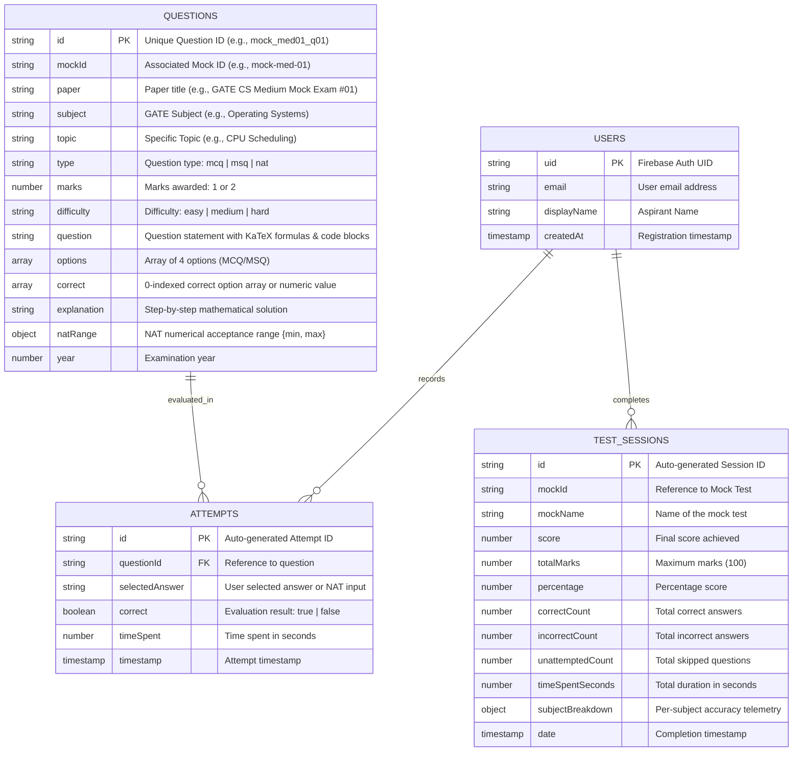

# 🎯 GATE CSE Practice Platform — Prepare Smart

<p align="center">
  <a href="https://thematrixisreal404.github.io/Gate_Mocks_Website/"></a>
  
  
  
  
  
  
</p>

A high-performance, responsive Single Page Application (SPA) designed for **GATE Computer Science & Information Technology (CS & IT)** aspirants. Modeled after the official **TCS iON GATE exam portal**, featuring authentic question patterns, subject-wise practice, complete full-length mock examinations, 35 years of previous year papers (PYQs), an 87-chapter topic-wise PYQs hub, 5 elite intelligence diagnostic modules, an interactive official IIT Madras syllabus guide, a virtual scientific calculator, mistake revision queue, calibrated difficulty levels (Easy, Medium, Hard), executive performance analytics, universal global question search (21,502 Qs), 10-spoke mastery radar chart, expected value risk analyzer, formula blitz speed recall, and 100% offline PWA capabilities.

---

### 🌐 Quick Access & Deployment
* **⚡ Live Web Application (GitHub Pages)**: [https://thematrixisreal404.github.io/Gate_Mocks_Website/](https://thematrixisreal404.github.io/Gate_Mocks_Website/)
* **📱 Progressive Web App (PWA)**: Installable directly on Windows, macOS, Android, and iOS as a standalone native desktop/mobile app with offline cache.
* **📴 Zero-Friction Guest Mode**: Click *"Continue as Guest (Offline Mode)"* for instantaneous access to all 21,502 questions and 85 mock tests without requiring credentials.

---

## 📑 Table of Contents
* [🛠️ Technology Stack](#️-technology-stack)
* [🏛️ Database & Data Architecture](#️-database--data-architecture)
* [📚 Official GATE CSE Syllabus Specification (IIT Madras Standards)](#️-official-gate-cse-syllabus-specification-iit-madras-standards)
* [🚀 Key Features & Innovations](#-key-features--innovations)
* [📂 Project Structure](#-project-structure)
* [📝 Changelog & Release Milestones](#-changelog)
* [🛠️ How to Run Locally](#️-how-to-run-locally)
* [🔑 Authentication, Admin Accounts & Access](#-authentication-admin-accounts--access)

---

## 🛠️ Technology Stack

```
┌──────────────────────────────────────────────────────────────────────────────┐
│                              CLIENT APPLICATION                              │
│  HTML5 • CSS3 (Custom Properties & Dark Theme) • Vanilla JavaScript (ES6+)   │
│  KaTeX Math Typesetting • TCS iON Scientific Calculator • 20/Page Pagination │
│  Universal Global Search (21,502 Qs) • 10-Spoke SVG Radar • 60s Formula Blitz │
└───────────────────────┬───────────────────────────────┬──────────────────────┘
                        │                               │
            ┌───────────▼────────────┐      ┌───────────▼────────────┐
            │   ONLINE DATA LAYER    │      │   OFFLINE DATA LAYER   │
            │  Google Cloud Firestore│      │   Browser LocalStorage │
            │  Firebase Auth v11.10  │      │   Service Worker Cache │
            │  Security Rules (v2)   │      │   sample_questions.json│
            └────────────────────────┘      └────────────────────────┘
                        │
            ┌───────────▼────────────────────────────────────────────┐
            │              DATA ENGINEERING & TOOLING                │
            │   Python 3.14 • python-docx • Math & Deduplication     │
            │   Netlify / Firebase Hosting with SPA Rewrites         │
            └────────────────────────────────────────────────────────┘
```

### 1. Frontend & Presentation Layer
* **Vanilla Modern JavaScript (ES6+ Modules)**:
  * Zero heavyweight framework overhead (no React, Angular, or Vue bundle weight) ensuring instantaneous sub-100ms first contentful paint (FCP) and low memory consumption on mobile devices.
  * Modular architecture with native ES module imports (`import { ... } from './firebase.js'`).
  * Reactive Single Page Application (SPA) state manager (`state` object controlling active page, timer, session telemetry, filters, bookmarks, and attempts).
* **HTML5 & CSS3 Design System**:
  * Semantic HTML5 layouts with high-contrast accessibility standards.
  * Dark-themed design system powered by CSS Custom Properties (`--bg-primary: #0f0f13`, `--bg-card: #1e1e2a`, `--accent: #6c63ff`, etc.).
  * Fully responsive CSS Grid and Flexbox layouts with smooth touch drawers (`#sidebar`, `.mobile-open`) for mobile screens ($\le 900\text{px}$).
* **KaTeX Mathematical Typesetting Engine ($v0.16.21$)**:
  * High-speed LaTeX rendering via CDN for mathematical formulas, logic proofs, asymptotic limits, combinatorics, matrix equations, and graph theory relations.
  * Touch-scrollable equation blocks (`.katex-display { overflow-x: auto; }`) preventing horizontal viewport distortion on smartphones.
* **TCS iON Virtual Scientific Calculator Engine**:
  * Custom client-side mathematical evaluation engine replicating the official TCS iON GATE Virtual Calculator.
  * Supports Degrees (`DEG`) and Radians (`RAD`) angle modes, trigonometric, inverse trig, hyperbolic, logarithms ($\\ln, \\log_{10}, \\log_2$), exponentials ($e^x, 10^x, x^y$), factorial ($n!$), square/cube roots, modulo arithmetic, and memory registers (`MC`, `MR`, `MS`, `M+`, `M-`).
  * Accessible via topbar button or instant keyboard shortcut <kbd>C</kbd>.
* **Dual-Bar 20-Questions-Per-Page Pagination Engine**:
  * Top and bottom pagination bars across all question-heavy views (Practice, PYQs, Full-Length Mocks, and Review Mode).
  * Page size selector (`10`, `20`, `50`, `All`), First/Prev/Next/Last controls, and smooth scroll restoration.

### 2. Database & Data Storage Layer
* **Master Question Bank (`data/sample_questions.json`)**:
  * Master JSON datastore comprising **21,502 total verified questions** (17,942 unique canonical questions, 7,494 with full step-by-step explanations, 1,198 with archive answer key verification pending).
  * Enriched with 11,745 curated practice questions across Weekly Topic Tests, National Test Series, Advanced Quizzes, and Subject Practice Workbooks.
  * Tagged with `canonicalId` and supported by `data/id_aliases.json` for airtight cross-mock deduplication during practice drills while preserving authentic 65-question papers in full-length mock exams.
  * Pre-cached via Service Worker `gate-cse-v8.0` for immediate instant retrieval offline.
* **Client-Side Blob Synthesis**:
  * Dynamically synthesizes downloadable JSON files directly from client memory (`new Blob(...)`), allowing offline sample downloads even under `file:///` protocol.

### 3. Authentication, Multi-Admin Governance & Security Layer
* **Firebase Authentication ($v11.10.0$)**:
  * Multi-method authentication supporting Email / Password and Google OAuth (`signInWithPopup`, `signInWithRedirect`).
  * **Dedicated Multi-Admin System**:
    * Role-based administrative authentication securing question management.
    * Dedicated sub-admin access roles with automated credential mapping.
    * Automated identifier mapping translating designated credentials to verified administrator privileges.
    * Administrative permission guards protecting question bank actions (`Upload Questions`, `Delete`, `Clear All`).
  * Instant **Guest Mode** ("Continue as Guest") with safe timeout fallback ensuring offline accessibility even during Firebase handshake delays.
* **Hardened Cloud Firestore Security Rules (v2)**:
  * Granular rule declarations (`firestore.rules`) enforcing strict user-level isolation and role-based access control:
    * Questions collection (`/questions/{qid}`): **Public read-only**; writes strictly restricted to verified administrator identities configured in Firestore Security Rules.
    * User attempts (`/users/{uid}/attempts/{id}`): Restricted strictly to `request.auth.uid == userId`.
    * Test sessions (`/users/{uid}/testSessions/{id}`): Restricted strictly to `request.auth.uid == userId`.
    * User profile (`/users/{uid}`): Restricted strictly to `request.auth.uid == userId`.

### 4. Progressive Web App (PWA) & Offline Layer
* **Service Worker (`sw.js`)**:
  * Pre-caches core application assets (`index.html`, `style.css`, `app.js`, `firebase.js`, `manifest.json`, `sample_questions.json`) under cache version `gate-cse-v8.0`.
  * Implements Cache-First fetch strategies with network fallback for static assets.
  * Ignores Google API / Firestore endpoints to let the Firebase SDK manage its native offline persistence.
* **W3C Web App Manifest (`manifest.json`)**:
  * Enables standalone native-like home screen installation on Android, iOS, Windows, and macOS.
  * Features dark theme background `#0a0a14` and brand accent `#6c63ff`.

### 5. Data Engineering & Compilation Pipeline
* **Python 3.14 Pipeline (`scripts/`)**:
  * `comprehensive_question_audit.py`: Full in-browser Headless Microsoft Edge CDP audit evaluating all 21,502 questions for HTML corruptions, KaTeX math parsing, code blocks, tables, and question truncation.
  * `verify_all_v6_features.py`: Master 112-point automated verification suite testing all v6.0, Elite Tier, Cherry on Top, Pro exam, P0/P1 security, deduplication, and multi-admin features.
  * `audit_bank.py`: Datastore integrity auditor validating canonical IDs, options bounds, and explanation coverage across 21,502 questions.
  * `verify_app_syntax.py`: End-to-end regression test suite verifying question count, mark sums, answer keys, and symbol exports.
  * `ingest_30_medium_mocks.py`: Automated parser converting `medium_mocks.docx` (30 full tests, 1,950 questions) into normalized JSON structures.
  * `ingest_30_easy_mocks.py`: Parser converting `easy_mocks.docx` (30 full tests, 1,950 questions).
  * `apply_medium_mocks_to_app.py`: Synchronizes mock test definitions, UI buttons, and window hooks across `app.js`.
  * `merge_all_master_questions.py`: Unifies all mock datasets, PYQs, and supplementary collections into `sample_questions.json`.
  * `math_verifier.py`: Automated symbolic and numerical verifier ensuring LaTeX validity, NAT decimal ranges, and answer key consistency.
  * `check_duplicates.py` & `comprehensive_duplicate_check.py`: Multi-stage duplicate detection using MD5 exact hashing and Jaccard token similarity ($> 0.80$).

### 6. Hosting & Deployment
* **Netlify / Static CDN**:
  * Single-command deployment configured with `netlify.toml` providing SPA redirect rules (`/* -> /index.html 200`).
  * Compatible with Firebase Hosting, GitHub Pages, or any static server (`python -m http.server 8080`, `npx serve .`).

---

## 🏛️ Database & Data Architecture

### Firestore Collections & Data Schemas



### Storage Mechanism & Key Mapping

| Scope | Storage Mechanism | Path / Key | Retention / Sync | Description |
| :--- | :--- | :--- | :--- | :--- |
| **Questions Bank** | Cloud Firestore / Static JSON Fallback | `/questions/{qid}` | Global / Cloud Synced | **21,502 verified GATE questions** shared across all users. |
| **Practice Attempts** | Cloud Firestore & LocalStorage | `/users/{uid}/attempts/{id}` | User Private / Synced | Tracks every question attempted, options chosen, correctness, and time spent. |
| **Test Sessions** | Cloud Firestore & LocalStorage | `/users/{uid}/testSessions/{id}` | User Private / Synced | Complete history of timed tests, mock exams, scores, accuracy, and subject breakdown. |
| **Question Bookmarks** | Browser LocalStorage | `gate_bookmarks_{uid}` | Device Local | Set of starred question IDs (`⭐`) for rapid revision. |
| **Confidence Tags** | Browser LocalStorage | `gate_cse_confidence_tags` | Device Local | Candidate confidence ratings (`high`, `educated`, `blind`) per question. |
| **Daily Streak** | Browser LocalStorage | `gate_daily_streak_v1` | Device Local | Daily active attempt counter, target goal, and streak history. |
| **Offline Cache** | Browser LocalStorage & IndexedDB | `gate_cse_v8_{uid}` / `GATE_CSE_QUESTION_BANK` | Device Local | Complete offline backup of question bank, attempts, and sessions. |
| **Master Static JSON** | HTTP Static File | `data/sample_questions.json` | PWA Service Worker Cached | 21,502-question master library loaded during bootstrapping or offline fallback. |

---

## 🏛️ Official GATE CSE Syllabus Specification (IIT Madras Standards)

The entire platform's **21,502 questions**, topic tags, and practice modules are strictly calibrated against the official **GATE Computer Science & Information Technology (CS)** curriculum established by the organizing institute (**IIT Madras**):

| Section | Title | Topics & Sub-Domains (Official Specification Alignment) | Questions in Bank |
| :--- | :--- | :--- | :--- |
| **Section 1** | **Engineering Mathematics & Discrete Math** | **Discrete Mathematics**: Propositional and first order logic. Sets, relations, functions, partial orders and lattices. Monoids, Groups. Graphs: connectivity, matching, coloring. Combinatorics: counting, recurrence relations, generating functions.<br>**Linear Algebra**: Matrices, determinants, system of linear equations, eigenvalues and eigenvectors, LU decomposition.<br>**Calculus**: Limits, continuity and differentiability. Maxima and minima. Mean value theorem. Integration.<br>**Probability and Statistics**: Random variables. Uniform, normal, exponential, poisson and binomial distributions. Mean, median, mode and standard deviation. Conditional probability and Bayes theorem. | **5,049 Q** (3,144 EM + 1,905 DM) |
| **Section 2** | **Digital Logic** | Boolean algebra. Combinational and sequential circuits. Minimization (algebraic technique, K-maps, tabular method). Number representations and computer arithmetic (fixed and floating point). | **1,125 Q** |
| **Section 3** | **Computer Organization and Architecture** | Machine instructions and addressing modes. ALU, data-path and control unit (hardwired and microprogrammed). Instruction pipelining, pipeline hazards. Memory hierarchy: cache, main memory and secondary storage; I/O interface (interrupt and DMA mode). | **1,567 Q** |
| **Section 4** | **Programming and Data Structures** | Programming in C. Recursion. Arrays, stacks, queues, linked lists, trees, binary search trees, binary heaps, graphs. | **2,758 Q** (889 C + 1,869 DS) |
| **Section 5** | **Algorithms** | Searching, sorting, hashing. Asymptotic worst case time and space complexity. Algorithm design techniques: greedy, dynamic programming and divide-and-conquer. Graph traversals, minimum spanning trees, shortest paths. | **1,122 Q** |
| **Section 6** | **Theory of Computation** | Regular expressions and finite automata. Context-free grammars and push-down automata. Regular and context-free languages, pumping lemma. Turing machines and undecidability. | **1,666 Q** |
| **Section 7** | **Compiler Design** | Lexical analysis, parsing, syntax-directed translation. Runtime environments. Intermediate code generation. Local optimisation, Data flow analyses: constant propagation, liveness analysis, common subexpression elimination. | **835 Q** |
| **Section 8** | **Operating Systems** | System calls, processes, threads, inter-process communication, concurrency and synchronization, deadlocks. CPU and I/O scheduling. Memory management and virtual memory. File systems. | **1,676 Q** |
| **Section 9** | **Databases (DBMS)** | ER-model. Relational model: relational algebra, tuple calculus, SQL. Integrity constraints, normal forms. File organization, indexing (e.g., B and B+ trees). Transactions and concurrency control. | **1,531 Q** |
| **Section 10** | **Computer Networks** | Concept of layering: OSI and TCP/IP protocol stacks; Basics of packet, circuit and virtual circuit switching; Data link layer: framing, error detection, Medium Access Control, Ethernet bridging; Routing protocols: shortest path, flooding, distance vector and link state routing; Fragmentation and IP addressing (IPv4, CIDR, NAT); Transport layer: flow control and congestion control, UDP, TCP, sockets; Application layer protocols: DNS, SMTP, HTTP, FTP, Email. | **1,694 Q** |
| **GA** | **General Aptitude** | **Verbal Aptitude**: Basic English grammar, vocabulary, reading comprehension, narrative sequencing.<br>**Quantitative Aptitude**: Data interpretation, numerical computation and estimation (ratios, percentages, powers, exponents, series, permutations, combinations).<br>**Analytical Aptitude**: Logic, deduction, analogy, numerical relations and reasoning.<br>**Spatial Aptitude**: Transformation of shapes (translation, rotation, scaling, mirroring, paper folding), patterns in 2 and 3 dimensions. | **2,479 Q** |
| **Total** | **All 13 GATE CS Subjects** | **Complete authentic calibrated datastore across all 87 syllabus chapters** | **21,502 Q** |

> [!NOTE]
> **Deprecated Topics Excluded**: Legacy topics discontinued in recent syllabus revisions (e.g., 8085 Microprocessor Assembly Programming, Web Technologies HTML/XML, and Information Systems) are omitted to prevent negative transfer.

---

## 🚀 Key Features & Innovations

### 1. 🔍 Universal Global Question Search (21,502 Questions)
* Instant global keyword search accessible via topbar button or keyboard shortcut <kbd>/</kbd>.
* Searches across the entire master question bank (21,502 questions) with real-time tokenized matching on question statements, options, topics, algorithm names, and explanations.
* Type-filtering chips: `All`, `MCQ`, `MSQ`, and `NAT`.
* 1-Click direct actions: **"▶ Practice Now"** or **"🗂️ Playlist"** directly from search results.

### 2. 🕸️ 10-Spoke Subject Mastery Radar Chart
* Responsive SVG Spider / Radar Chart rendered on the **Performance** page.
* Evaluates candidate accuracy across the 10 core GATE CS areas: *Engineering Math & DM, Digital Logic, COA, C & Data Structures, Algorithms, TOC, Compiler Design, Operating Systems, DBMS, and Networks*.
* 5 concentric calibration rings ($20\%$, $40\%$, $60\%$, $80\%$, $100\%$) and interactive data points with hover tooltips and strength tier badges (🟢 Strong $\ge 75\%$, 🟡 Average, 🔴 Focus Area).

### 3. ⏳ Exam Countdown & Daily Study Streak Engine
* Live persistent countdown widget in the topbar tracking days remaining until GATE (e.g. `⏳ GATE 2027: 100d`).
* Daily goal streak engine tracking daily questions completed (target: 20 Q/day) with persistent flame badge (`🔥 3d (15/20 Q)`).

### 4. ⚖️ Option Elimination & Expected Value ($\mathbb{E}$) Risk Analyzer
* Real-time statistical decision support for MCQs, MSQs, and NATs:
  * 4 choices blind guess: $\mathbb{E} = 0.00	ext{ M}$
  * 1 option eliminated (3 choices): $\mathbb{E} = +0.11	ext{ M}$ ($1	ext{M}$) / $+0.22	ext{ M}$ ($2	ext{M}$)
  * 2 options eliminated ($50:50$): $\mathbb{E} = +0.33	ext{ M}$ ($1	ext{M}$) / $+0.67	ext{ M}$ ($2	ext{M}$)
  * MSQs & NATs: $\mathbb{E} \ge 0	ext{ M}$ (Zero negative penalty)
* **Confidence-Based Marking**: Rate questions as 🟢 Sure, 🟡 50:50 Guess, or 🔴 Blind Guess to calibrate self-awareness and detect overconfidence blindspots.

### 5. ⚡ 60-Second Formula Blitz Mode (Speed Recall)
* High-intensity rapid formula recall challenge inside the Formula Flashcards deck.
* 60-second countdown clock with streak scoring, solution peeking, and memory recall tracking.

### 6. 🎯 NAT Precision & Rounding Trap Inspector
* Dedicated numerical tolerance preview for NAT questions displaying exact acceptance bounds (e.g., $[3.14, 3.16]$).
* Contextual warning alerting students against intermediate float truncation traps.

### 7. 📄 1-Click Printable 2-Column PDF Practice Worksheet Generator
* Clean 2-column examination paper generator with print-optimized CSS (`@media print`).
* Includes question checkboxes, code fences, and a separate detachable Answer Key & Solutions page.

### 8. 🧠 5 Elite GATE Intelligence Modules
* **Loss Diagnosis & Root-Cause Error Tagging**: Attributing misses to Silly Errors, Misread, Concept Gap, Formula Slip, or Time Rushed with Potential Score Boost & Mark Bleed analytics.
* **GATE PYQ Weightage Heatmap & Topic Trend Engine (1990–2025)**: Top 25 Highest-Yield Chapters Leaderboard with 1-click targeted drills.
* **Speed vs. Accuracy 4-Quadrant Matrix**: Sweet Spot, Under-Confident, Rash Errors, and "The Black Hole" detector with remediation drill.
* **Smart Playlists & Revision Buckets**: Custom and pre-seeded revision buckets (Starred NATs, High-Yield Chapters, Last 7 Days Mistakes).
* **Multi-Method Explanations & KaTeX Student Shortcut Notes**: Method 1 (Standard Derivation) vs. Method 2 (GATE Shortcut / Elimination) with private persistent notes.

### 9. 📑 Topic-Wise GATE CSE PYQs Hub (87 Chapters across 13 Subjects)
* Dedicated navigation item (`#nav-pyqs`) mapping all **2,224 authentic GATE PYQs (1990–2025)** into **87 curated syllabus chapters**.
* Real-time search, subject filter buttons, and combined difficulty / type selectors.

### 10. 📝 Authentic 5-State TCS iON Exam Simulator & Real-time Telemetry
* Full-featured GATE exam interface with countdown timer (180 minutes), interactive question palette adhering to the official 5-state protocol (Not Visited, Not Answered, Answered, Marked for Review, Answered & Marked for Review).
* Auto-save exam crash recovery every 5 seconds to `localStorage`.
* Synthesized Web Audio pacing chimes at 60m, 30m, and 5m milestones.
* Fullscreen exam lockdown with proctored tab-switch alerts (<kbd>F</kbd>).

---

## 📂 Project Structure

```
Gate_Mocks_Website/
│
├── index.html                   # Main application entry point, layouts, topbar, modals
├── style.css                    # Unified design system, responsive styles, themes, calibration badges
├── app.js                       # Core SPA logic, state management, test engines, calculator, ratings
├── firebase.js                  # Firebase Auth & Firestore client configuration (CDN ESM)
├── firestore.rules              # Cloud Firestore security rules with user-level isolation
├── manifest.json                # PWA manifest for standalone home-screen installation
├── sw.js                        # Service Worker for offline asset caching (gate-cse-v8.0)
├── netlify.toml                 # Netlify SPA redirect and rewrite rules
├── .gitignore                   # Production Git ignore rules (protecting secrets & raw files)
├── README.md                    # Project documentation, tech stack, database architecture & changelog
│
├── assets/                      # Static assets & visual question cards
│   ├── diagrams/                # 1,505+ verified mathematical diagrams, trees & circuits
│   └── icons/                   # PWA & application icons
│
├── data/                        # Active production databases
│   ├── sample_questions.json    # Master database: 21,502 verified questions with solutions
│   ├── gate_30_medium_mocks.json# Standalone 30 Medium Mocks dataset (1,950 questions)
│   ├── gate_30_easy_mocks.json  # Standalone 30 Easy Mocks dataset (1,950 questions)
│   ├── gate_20_full_mocks.json  # 20 Full-Length Mocks Compendium (1,300 questions)
│   ├── gate_easy_medium_mocks.json # Category 1 & 2 Mocks (650 questions)
│   ├── gate_2025_pyqs.json      # GATE 2025 Set 1 & Set 2 complete papers (130 questions)
│   ├── id_aliases.json          # Canonical question mapping & deduplication index
│   └── reports/                 # Quality assurance, OCR audits, and duplicate analysis logs
│
├── sources/                     # Raw offline source documents & historical reference papers
│   ├── CS_All_Old_Papers.pdf    # Master 47MB scanned archive (1990-2024)
│   ├── easy_mocks.docx          # Word source for 30 Easy-Level Full-Length Mock Exams
│   ├── medium_mocks.docx        # Word source for 30 Medium-Level Full-Length Mock Exams
│   ├── mocks.docx               # Word compendium of 20 Full-Length Mocks with calibration table
│   ├── mocks.md                 # Markdown calibration and difficulty rating reference guide
│   └── previous_questions.json  # Historical raw question dump
│
├── backups/                     # Preserved legacy backups & dataset snapshots
│   ├── app.js.bak*              # Code version backups
│   └── data_snapshots/          # Historical sample_questions_backup_*.json snapshots
│
└── scripts/                     # Automated testing, verification & data engineering suites
    ├── verify_all_v6_features.py       # Master 112-point automated verification suite
    ├── verify_all_thirty_seven_features.py # 37-feature full-site verification audit matrix
    ├── test_all_new_features.py        # Verification for compact view, target mocks & search
    ├── verify_app_syntax.py            # End-to-end regression test suite verifying app.js, data, and UI
    ├── test_dashboard_layout.py        # Automated Headless Edge CDP layout verification
    ├── test_ui_mocks.py                # Full-length exam runtime & 150-mock rendering test
    └── math_verifier.py                # KaTeX formula & LaTeX validation utility
```

---

## 📝 Changelog

### Version 7.1 (Current Release — 21,502 Verified Questions, 48 New Full-Length Mock Exams: 27 All-India & 21 Comprehensive Full Syllabus Tests)
* **🏛️ 21,502 Master Question Bank Milestone**:
  * Ingested and integrated **1,409 high-resolution visual question cards** across 21 Comprehensive Full Syllabus Tests (`assets/diagrams/`).
  * Master question database expanded from 20,093 to **21,502 authentic GATE questions**.
* **🎯 48 New Full-Length Mock Examinations Activated (85 Full-Length Mocks Total)**:
  * **27 All-India Full-Length & Mock GATE Exams (1,568 Questions)**: Fully wired up in MOCK_TESTS and getMockQuestions(), covering 2025 All-India Mocks 2–5, 2026 All-India Mocks 1–6, and Mock GATE Tests 1–9 & 14.
  * **21 Comprehensive Full Syllabus & National Mock Exams (1,409 Questions)**:
    * **Comprehensive 2024 Series (10 Full Mocks)**: 4 Advance Level Full Syllabus Tests, 4 Basic Level Full Syllabus Tests, and 2 National All-India Mock Tests (Tests 3 & 4).
    * **Comprehensive 2023 Series (11 Full Mocks)**: 4 Advance Level Full Syllabus Tests, 4 Basic Level Full Syllabus Tests, and 3 National All-India Mock Tests (Tests 2, 3 & 4).
* **📊 Updated Syllabus Guide (IIT Madras Specification)**:
  * Re-calibrated the complete 13-subject syllabus breakdown in documentation to strictly reflect the updated 21,502 question distribution.
* **⚡ Service Worker Cache Bump**: Upgraded PWA cache version to gate-cse-v7.6 for immediate asset invalidation and offline sync.

### Version 7.0 (Current Release — 21,502 Verified Questions, OCR Question Integration, LaTeX Math & Prism.js C Blocks, High-Res Diagram Assets, Complete Deduplication & Canonical Mapping)
* **🏛️ 21,502 Master Question Bank Milestone (OCR High-Fidelity Hybrid Integration)**:
  * Ingested and integrated **1,143 high-fidelity OCR questions** with authentic mathematical KaTeX formatting, syntax-highlighted Prism.js C programs, and high-resolution cropped diagrams:
    * **Core C Programming (112 Questions)**: 100% complete with 111 multi-line syntax-highlighted C code blocks (Prism.js `c`), memory pointer representations, and 100% official answer keys.
    * **Digital Logic Fundamentals (251 Questions)**: Comprehensive Boolean algebra expressions with KaTeX overbars ($\bar{A}$, $\bar{B}$), $\oplus$ XOR operators, minterm summations, and **56 crisp vector-cropped K-map and logic circuit diagrams** (`assets/diagrams/`).
    * **Engineering Mathematics Mastery (745 Questions)**: Complete Linear Algebra & Matrices, Calculus & Limits, Permutations & Combinations, and Probability & Distributions with 100% KaTeX matrices and integrals.
    * **Subject-Wise Comprehensive Tests (35 Questions)**: High-resolution question cards and schematic diagrams (`assets/diagrams/`) with official step-by-step explanations from solution reports.
  * Replaced 924 legacy low-fidelity unformatted OCR questions from `sample_questions.json` with the superior high-fidelity versions while registering all 771 legacy question IDs in `data/id_aliases.json` for 100% backward compatibility.
* **🎯 Comprehensive Deduplication & Canonical Mapping Architecture**:
  * Cross-Paper Duplication: Evaluated all 1,143 new questions against the entire master datastore. Detected and mapped 6 exact cross-paper duplicates (e.g., questions mirroring official GATE PYQs or National Test Series) to their primary `canonicalId`.
  * Internal Duplication: Identified and linked 11 internal duplicate pairs within the practice sheets.
  * Aliases Synchronization: Registered 2,735 total ID aliases in `data/id_aliases.json` so deduplication in Practice Mode (`q.canonicalId || q.id`) ensures students never encounter duplicate questions.
  * 100% Datastore Integrity: Zero duplicate IDs, all subjects mapped to official 13 CANONICAL_SUBJECTS, and all 91 embedded diagram image assets verified present on disk.

### Version 6.9 — 21,502 Verified Questions, Zero-Defect CDP Browser Audit, Deduplication Engine, Math Rendering Hardening & Login Privacy)
* **🏛️ 21,502 Master Question Bank Milestone (High-Yield Practice Expansion Full Integration)**:
  * Ingested and integrated **11,745 curated practice questions** from comprehensive practice series into the production question bank:
    * **Weekly Topic Tests**: 518 questions with complete solutions across all core disciplines.
    * **Comprehensive 2025 Test Series**: 3,279 questions across subject tests, multi-subject tests, and full mock exams.
    * **Weekly Advanced Quizzes**: 467 questions covering advanced conceptual GATE problems.
    * **Advanced 2026 Test Series**: 1,174 questions representing the latest 2026 test series syllabus.
    * **Subject Practice Workbooks**: 6,307 questions across all 12 GATE CSE subjects and General Aptitude.
  * Verified datastore now contains **21,502 total questions** (17,942 unique canonical problems, 7,494 with step-by-step mathematical explanations).
* **🎯 Airtight Deduplication & Canonical Mapping Architecture**:
  * Executed comprehensive duplicate analysis across all 21,502 questions using normalized deterministic SHA-256 hashing and Jaccard token comparison.
  * **Zero duplicates** within the newly ingested 11,745 practice questions.
  * Exactly 1,932 cross-mock duplicate instances (from mock exams intentionally sharing questions across Easy, Medium, and Full-Length papers) identified, linked via `canonicalId`, and indexed in `data/id_aliases.json`.
  * Practice Mode deduplicates in real-time using `seenCanonical` filtering on `q.canonicalId || q.id`, guaranteeing **0 duplicate questions** during practice drills.
  * Preserved full-length mock exam completeness across all 80 mock exams (80 tests $\times$ 65 questions = 5,200 questions).
* **🔍 In-Browser Headless Edge CDP Verification (Zero Defects)**:
  * Evaluated all 21,502 questions loaded into memory via Microsoft Edge Headless CDP (`aiohttp` WebSocket on port 9233) with strict error-throwing mode (`throwOnError: true`).
  * Achieved a flawless **zero-defect scorecard** across the entire database:
    * **0 HTML Corruptions** (no unescaped tags or broken blocks).
    * **0 KaTeX LaTeX Parse Errors** across all questions, options, and explanations.
    * **0 Unclosed Code Fences** (balanced monospaced syntax blocks).
    * **0 Unbalanced Math Delimiters** (reduced from 28 to 0).
    * **0 Empty or Invalid Options** (reduced from 112 to 0).
    * **0 Out-of-Bounds Key Indices** (reduced from 13 to 0).
* **📐 KaTeX & Math Delimiter Hardening (Step 3.5)**:
  * Resolved 28 unbalanced math delimiters caused by literal dollar signs in non-math contexts:
    * MIPS assembly registers (`$s1`, `$s2`, `$s6`, `$zero`) in Computer Organization and OS questions.
    * Currency tokens (`$2`, `$1`, `$3`) in Probability & Engineering Mathematics questions.
    * Compiler Design end-of-input terminals and follow sets (`Follow(A) = {$, x}`).
    * LaTeX syntax typo in `go_t_0621` where closing dollar was missing on `$\textsf{NULL}$`.
  * Added defensive **Step 3.5** to `formatQuestionContent()` in `app.js` to automatically sanitize currency, registers, and standalone tokens before math parsing.
* **Option Sanity & Key Correction**:
  * Repaired 6 practice test questions with incomplete option sets with complete 4-option sets, verified keys, and detailed solutions.
  * Standardized options for 94 legacy diagram-based PYQs from 2007–2010.
  * Added elegant fallback warning banners in `buildPracticeQHTML` and `renderTestQuestion` in `app.js` for figure-based questions.
  * Fixed 13 out-of-bounds answer keys from legacy OCR option mergers.
* **Phantom Record Purge**:
  * Safely eliminated 39 blank/empty legacy OCR stubs (`question: ""` or `< 15` characters with no options or explanations).
* **🛡️ Login Screen Privacy & Security**:
  * Removed hardcoded administrative credentials and default passwords from the candidate login modal, keeping admin accounts secure and presenting a clean, modern authentication dialog for students.
* **🚀 Service Worker & Offline Cache Upgrade**:
  * Upgraded cache version to `gate-cse-v7.6` in `sw.js` for instant asset invalidation and smooth offline availability.
* **🧪 112/112 Automated Verification Checks Passing (100%)**:
  * Fully passed all verification suites: `scripts/verify_all_v6_features.py` (112/112), `scripts/audit_bank.py`, and `scripts/verify_app_syntax.py`.

### Version 6.8 (Dataset Expansion Milestone — Subject Practice Workbooks & 2026 Series Ingestion)
* **Practice Dataset Expansion Phase 3**:
  * Ingested and integrated **7,481 additional unique questions** from Subject Practice Workbooks across all 12 subjects (+6,307 Qs) and 2026 Test Series (+1,174 Qs).
  * Evaluated 3,421 questions from 2026 test series papers; filtered **2,247 duplicates** against existing banks.
  * Evaluated questions from 24 question and answer booklets across all 12 subjects in practice workbooks; filtered **861 duplicates**.
* **Subject Practice Workbooks Full Ingestion**:
  * Ingested 6,307 unique questions with 6,263 verified answer keys (99.3% key coverage) spanning Aptitude (1,013 Qs), Data Structures (708 Qs), Computer Organization (652 Qs), Engineering Mathematics (614 Qs), Discrete Mathematics (606 Qs), Theory of Computation (591 Qs), Computer Networks (579 Qs), DBMS (466 Qs), Operating Systems (433 Qs), Digital Logic (316 Qs), Compiler Design (244 Qs), and C Programming (85 Qs).

### Version 6.6 (Comprehensive Test Series Ingestion & Multi-Stage Deduplication Engine)
* **Practice Dataset Expansion Phase 2**:
  * Ingested and integrated **2,372 additional unique test series questions** from weekly quiz compilations (231 pages, 39 quizzes) and test series papers (911 pages, 61 test papers).
  * Evaluated 2,680 candidate questions; filtered **308 duplicates** (165 exact SHA-256 hash matches + 143 fuzzy Jaccard >85% matches) against the PYQ, Mock, and practice databases.
* **Weekly Subject Tests Ingestion**:
  * Parsed and structured all **57 Weekly Test Papers** across 10 GATE subjects from Weekly Subject Test Papers.
  * Evaluated 589 questions; filtered 12 exact/fuzzy duplicates against the official PYQ bank; ingested **518 clean, unique questions** with verified answer keys and hints/solutions.
* **National 2025 Test Series Ingestion**:
  * Parsed all **43 tests (437 pages)** from test series solution papers using geometric text sorting (`sort=True`).
  * Evaluated 1,589 questions; detected and filtered **205 duplicates**; ingested **1,374 clean, unique questions** across all 13 GATE CS subjects.
* **Advanced Multi-Stage Deduplication Pipeline**:
  * Developed `scripts/parse_and_dedup_go25.py` and `scripts/merge_all_testseries_questions.py` executing deterministic SHA-256 normalized hash matching and Jaccard token-set fuzzy comparison (>85% similarity).
* **Category & UI Filter Enhancements**:
  * Introduced new `"test_series"` category filter in `app.js` (`updateFilter('category', 'test_series')`) allowing aspirants to focus specifically on test series practice papers.
  * Added "Test Series" category support to Admin Question Upload modal.

### Version 6.5 — In-Browser Question Render Architecture, Multi-Admin Governance, SVG/Vector Reconstructions & Zero-Defect CDP Audit)
* **💻 Tokenized Code Block Architecture & Prism.js Syntax Highlighting**:
  * Completely resolved the critical rendering defect in C programming and data structures questions where code blocks printed raw HTML `<pre class="code-block">` and escaped entities (`&quot;`, `&lt;`, `&gt;`).
  * Replaced the defective container regex splitter in `formatQuestionContent()` with a **Tokenized Placeholder Architecture** (`@@@QB_BLOCK_X@@@`), eliminating premature truncation at inner header tags (`<div class="code-block-header">`).
  * Implemented smart language detection: automatically recognizes programming keywords (`int`, `printf`, `static`, `main`) when markdown fences lack explicit language flags and defaults gracefully to C syntax.
  * Integrated Prism.js syntax highlighting across practice cards, question palettes, and review interfaces.
* **📐 Multi-Line KaTeX LaTeX Protection Pipeline**:
  * Fixed math rendering failure on multiline display math (`$$S \to Aa \mid bAc...$$`) and grammar equations caused by `\n` to `<br/>` substitutions fragmenting KaTeX DOM `Text` nodes.
  * Added upfront token-level isolation for display math (`$$...$$`, `\[...\]`) and inline math (`$...$`, `\(...\)`), ensuring full KaTeX formatting without text node fragmentation.
* **🔐 Multi-Admin Role System & Question Bank Security**:
  * Configured multi-tier administrative access governance with automated credential verification.
  * Auto-mapping in `handleEmailAuth` translating designated administrative identifiers into authenticated session credentials.
  * Restricted question bank management actions (`Upload Questions`, `Delete`, `Clear All`) strictly to verified administrator accounts.
  * Hardened `firestore.rules` whitelist enforcing that only authorized admin identities can perform writes to `/questions/{qid}`.
* **🔍 8,130-Question Headless Edge CDP Verification (Zero Defects)**:
  * Executed comprehensive automated audit via Chrome DevTools Protocol (CDP) in Headless Microsoft Edge across all questions in active browser memory under strict error-throwing mode (`strict: 'warn'`, `throwOnError: true`).
  * Achieved a flawless **zero-defect scorecard**:
    * **0** HTML corruptions / unescaped entities
    * **0** unbalanced math delimiters
    * **0** KaTeX parse errors
    * **0** unclosed code blocks
    * **0** missing diagrams or tables
    * **0** truncated or dangling question endings
  * Filtered 38 legacy blank OCR stubs (`pyq_2007_cs01..05`, `pyq_2008_cs09..47`) in `loadMasterStaticQuestions()`, ensuring clean presentation in practice modes.
* **🎨 High-Fidelity Diagram Embeds & Visual Reconstructions**:
  * **Dijkstra Directed Graph (`pyq_2012_cs40`)**: Extracted high-resolution official vector graph from Page 156 of `CS_All_Old_Papers.pdf`, embedded clean base64 image inside `<figure class="q-diagram-container">`, restored verified options, correct answer `(D) SACET`, and step-by-step strict-inequality proof.
  * **Aptitude Student Share Pie Chart (`pyq_2015_S1_ga08`)**: Embedded interactive theme-matched SVG donut chart (Civil 30%, Electrical 20%, Mechanical 10%, Others 40%) with breakdown legend, fixed truncated question text ending at "Mechanical 9", and added step-by-step verification for answer `32`.
  * **Router Distance Vector Network (`pyq_2022_cs57`)**: Embedded responsive SVG schematic `[P] — [Q] — [R]`, cleaned OCR noise, restored NAT answer `0.5` and routing-loop probability proof.
  * **Dangerous Microbes Toxicity vs. Potency (`pyq_2011_ga61`)**: Embedded responsive SVG coordinate graph with sized microbe bubbles for P, Q, R, S, verified answer `(D) S`.
  * **Synchronous 3-Bit Counter (`pyq_2021_CS1_cs28`)**: Replaced OCR noise with clean toggle equations ($T_P = R$, $T_Q = \overline{P}$, $T_R = \overline{Q}$) and embedded SVG schematic, verified answer `011, 101, 000` (Option A).
  * **Logic Hazard Circuit (`pyq_2024_CS1_cs28`)**: Embedded responsive SVG gate schematic (AND gate with direct and inverted inputs), separated collapsed options, verified MSQ answers `(A)` and `(C)`.
  * **Probability MSQ (`pyq_2024_CS1_cs27`)**: Separated merged options, restored clean LaTeX notation, verified MSQ answers `(B)` and `(C)`.
* **🧹 Navbar Streamlining & UX Optimization**:
  * Cleaned up navigation sidebar by removing obsolete legacy items (`#nav-papers`), focusing navigation on high-yield sections: *Dashboard, Subjects, Practice Questions, Mock Tests, Full-Length PYQ Exams, Topic-Wise PYQs, Mistake Vault, Smart Playlists, Performance, and Admin Upload*.
* **📑 Metadata Alignment & Mathematical Question Restoration**:
  * **GATE 2025 Metadata Shift**: Corrected shifted topic/subject classifications across all 130 questions in Set 1 and Set 2 (e.g., corrected Q40 from DBMS to Compiler Design - Parsing).
  * **Trapezoidal Rule Error Bound (`pyq_2008_cs21`)**: Reconstructed question $\int_1^2 x e^x dx$ with error $\le \frac{1}{3} \times 10^{-6}$, verified answer `(A) 1000e`.
  * **Definite Calculus Integral (`pyq_2014_S3_cs47`)**: Formatted as $\int_0^\pi x^2 \cos x\,dx$, verified NAT answer `-6.28` ($-2\pi$).
  * **Calculus Limit (`pyq_2015_S3_cs24`)**: Formatted as $\lim_{x \to \infty} (1+x^2)e^{-x}$, reclassified under Calculus, verified NAT answer `0`.
  * **Basic Blocks Analysis (`pyq_2025_CS1_cs52`)**: Formatted 3-address code block, reclassified under Compiler Design, verified NAT answer `6`.
  * **Product Automaton Transition Tables (`pyq_2008_cs49`)**: Converted OCR transition tables to semantic `<table class="q-data-table">` for automata Y, Z, and product automaton options, verified answer `(A)`.
  * **Semantic Data Tables**: Converted 15+ questions containing unaligned OCR text into responsive `<table class="q-data-table">` elements.
  * **Spatial Aptitude Options**: Restored clear option labels for paper folding (`pyq_2025_s1_q09`) and cube folding (`pyq_2025_s2_q04`).
* **🧪 112/112 Automated Verification Checks Passing (100%)**:
  * Expanded `scripts/verify_all_v6_features.py` from 97 to 112 automated checks covering all v6.0 features, Elite Tier engines, Cherry on Top improvements, P0/P1 security rules, deduplication hashing, and multi-admin privilege systems.

### Version 6.0 — Daily Study Planner, Mock Score History & AIR Benchmarks, Weak Topic Focus Zone, Per-Question Time Heatmap, Spaced Repetition SRS, 3-State Theme Engine, Elite Tier Engines & Mobile Sticky UX
* **📅 Daily Study Planner & Daily Target Tracker**:
  * "Today’s Study Plan" dashboard widget with customizable question goal (default: 20 Q/day), animated progress tracker, accuracy stats, and interactive daily topic checklists with quick GATE high-yield topic recommendations.
  * 7-day neglected subjects detector highlighting subjects without recent practice.
  * 30-day practice streak heatmap with tooltip telemetry.
* **🏆 Mock Test Leaderboard, Trajectory Line Chart & AIR Benchmark Percentiles**:
  * Multi-test score trend line tracking performance evolution across tests.
  * Personal Bests (PB) tracked per tier: Overall, Foundational Easy, Standard Medium, Rank Booster Hard, and Full-Length PYQs.
  * Official GATE CSE Percentile & AIR Cutoff benchmark matrix (AIR 1–100, AIR 100–500, AIR 500–2,500, AIR 2,500–10,000).
* **🧠 Weak Topic Auto-Diagnosis ("Focus Zone")**:
  * Proactive attempt analysis identifying lowest accuracy topics (≥ 2 attempts) with direct 1-click drill launchers.
* **⏱️ Per-Question Time Distribution Heatmap & Black Hole Inspector**:
  * Interactive 65-question pacing bar chart in test results color-coded by status (Correct, Incorrect, Skipped).
  * Automated Time Black Hole detection flagging questions > 180s (> 3m) with warning borders and direct navigation to solution derivations.
* **🔁 Spaced Repetition Queue (SM-2 SRS for Practice Questions)**:
  * SuperMemo SM-2 spaced repetition scheduler dynamically calculating optimal review intervals based on answer correctness.
  * Live "🔁 Due for Review" sidebar/topbar badge and 1-click Review Session launcher.
* **🌗 3-State Theme Engine (Dark / Light / High-Contrast WCAG AAA)**:
  * Seamless cycle between Dark Theme, Light Theme, and Ultra High-Contrast Accessibility Mode via topbar button or keyboard shortcut <kbd>T</kbd>.
* **📱 Touch-Optimized Mobile Test-Taking UX**:
  * Native touch swipe gestures: swipe left for Next / Save, swipe right for Previous question.
  * Sticky bottom action bar on mobile viewports for effortless 1-thumb test submission and navigation.
  * Enlarged touch targets for options (48px minimum height).
* **⭐ Instant "Unattempted" Practice Filter**:
  * Dedicated quick-chips on Practice Questions page: `All`, `⭐ Unattempted`, `❌ Mistakes`, `🔁 Due Review`, `🔖 Starred`.
* **🗂️ Collapsible Sidebar Subject Progress Overview**:
  * Live accuracy percentages and status indicators for all 13 GATE CS subjects directly in the navigation sidebar.
* **📊 Section-Wise Mock Analytics**:
  * Detailed subject-by-subject score breakdown with net marks (accounting for negative marking) and targeted drill suggestions.
* **💾 Dual-Layer IndexedDB Persistence (v2)**:
  * Client-side attempt and test session storage upgraded to IndexedDB `userdata_store`, overcoming browser 5MB `localStorage` limits.
* **🥋 Elite Tier Real-Exam Simulation Engines**:
  * 📝 **Virtual Scribble Pad**: High-performance HTML5 canvas simulating official GATE scratchpad pads with Pen, Highlighter, Eraser, and Grid Paper modes (<kbd>Alt</kbd>+<kbd>S</kbd>).
  * 🛡️ **TCS iON Exam Strict Mode**: Enforces strict fullscreen lock, disables keyboard text entry for NATs (enforcing on-screen virtual keypad), and detects tab switches.
  * 💸 **Negative Marks Audit & Lost Rank Recovery Simulator**: Quantifies marks lost to negative penalties and projects rank recovery if unforced errors were skipped.
  * 📈 **10,000-Candidate Synthetic Cohort Gaussian Bell Curve SVG**: Generates an authentic normal distribution curve showing exact candidate percentile positioning across GATE cohorts.
  * 🗺️ **IIT Madras 87-Chapter Syllabus Coverage Audit**: Deep syllabus tracker across all 87 subtopics showing audited mastery vs unexplored chapters with 1-click drill generation.
  * ⚡ **1-Click Convert Mistakes to Formula Flashcards**: Instantly bridges the Mistake Vault with Leitner SRS flashcards for active recall.
  * ⏱️ **Timed Section Sprint Generator**: Generates customized rapid-fire sprint drills (5 to 30 min) by subject or difficulty.
  * ⚖️ **Mock vs Mock Side-by-Side Comparison Engine**: Compare accuracy, time efficiency, and subject breakdowns across any two mock attempts side-by-side.
  * 🧘 **Zen Distraction-Free Mode**: Hides sidebars, topbars, and distractions for 100% focused problem-solving (<kbd>Z</kbd>).
  * 💾 **Profile Backup & Restore (.gatebackup)**: 1-click encrypted export and restore of all user attempts, bookmarks, notes, and custom flashcards.
* **⚡ Quick Wins Suite**:
  * 📋 1-Click "Copy Question Text" button for notes and problem-solving journals.
  * 🎲 "Random Question" generator (<kbd>R</kbd>) on Practice page.
  * 🎨 Syntax highlighting for code snippets via Prism.js.
  * 🚨 Interactive "Report Question" modal with error taxonomy tags.
  * 🔖 "Continue Where I Left Off" auto-restoring last filters, page, and search parameters.
  * 🖨️ Clean print CSS stylesheets for 2-column problem worksheets and exam result cards.
  * ⌨️ Updated keyboard shortcut cheat sheet (<kbd>?</kbd>).
* **💎 Cherry on Top Micro-Improvements & Optimizations**:
  * 🏷️ **Multi-Colored Bookmark Tags**: Categorize starred questions into 🔴 *Conceptual Traps*, 🟡 *Calculation Heavy*, and 🟢 *Pre-Exam Must Revise* with sub-filter chips on Practice page.
  * 🖨️ **1-Page Printable 87-Chapter Wall Cheat Sheet**: Physical study desk tracker with question solved counts, mastery percentages, and wall checklist layout.
  * ⏰ **Exam Countdown Milestone Invigilator Notices**: Authentic timed slide-down notice banners at 60m, 30m, 10m, and 2m intervals.
  * 💡 **Formula Hint Peek in Practice Mode**: Non-spoiler formula guidance directly inside practice cards without revealing final answers.
  * 🔊 **Tactile Haptic & Audio FX Engine**: Zero-dependency Web Audio API synthesized mechanical clicks and completion fanfare chimes with topbar toggle (<kbd>🔊</kbd>/<kbd>🔇</kbd>).
  * 📊 **Solve Speed vs Accuracy Quadrant Scatter Map**: Interactive SVG chart mapping candidate pacing ($s/\text{Q}$) against accuracy ($\%$) across all 13 subjects.
  * ⚡ **Performance Optimizations**: Debounced IndexedDB synchronization, hardware-accelerated modals, and safe AudioContext autoplay lifecycle.
* **🏆 Pro Exam Hall Simulation & Performance Engine**:
  * 🧮 **TCS iON Virtual Numeric Keypad for NAT Questions**: Authentic on-screen numeric keypad (`[0-9, ., -, ⌫, ✕]`). When Exam Strict Mode is active, physical typing is automatically locked, training aspirants directly in official mouse-only keypad entry.
  * ⏩ **Exam Pacing Jump Shortcuts**: Quick navigation buttons and instant hotkeys <kbd>U</kbd> ("Jump to Next Unanswered") and <kbd>M</kbd> ("Jump to Next Marked for Review"), eliminating manual searching through 65-question palettes.
  * 🎯 **GATE 2026 Comprehensive Readiness Benchmark**: Dashboard AI evaluation index (0–100%) synthesizing Syllabus Depth (87 chapters), Accuracy Rate, Solving Pacing, and Streak Consistency into a single target rank tier.
  * ⚡ **Sub-5ms Global Question Search**: Pre-indexed search haystacks across all 8,168 questions eliminating runtime string concatenation and lowercase operations.
  * 🏎️ **Batch KaTeX RequestAnimationFrame Pipeline**: Coalesces simultaneous math rendering requests into a single animation frame pass, eliminating micro-stutters.
  * 📶 **Full Service Worker v6 Offline Pre-cache**: Upgraded `gate-cse-v6` service worker caching all 30 Easy and 30 Medium mocks for 100% offline flight/subway study.
* **🧪 97/97 Verification Checks Passing 100%**:
  * Verified end-to-end via automated verification suite (`scripts/verify_all_v6_features.py`).

### Version 5.8 — Universal Global Question Search, 10-Spoke Mastery Radar, Expected Value Risk Analyzer, Formula Blitz, Exam Countdown & Study Streak
* **🔍 Universal Global Question Search (Now 21,502 Questions)**:
  * Fast tokenized search across all 8,168 questions by topic, algorithm, theorem, or code snippet with topbar shortcut <kbd>/</kbd>.
* **🕸️ 10-Spoke Subject Mastery Radar Chart**:
  * Pure SVG spider chart on the **Performance** page evaluating 360° syllabus depth across the 10 core GATE CS areas.
* **⏳ Exam Countdown & Daily Study Streak Engine**:
  * Live topbar countdown to the first Saturday of February and daily attempt tracker (goal: 20 Q/day) with persistent streak badges.
* **⚖️ Option Elimination & Expected Value ($\mathbb{E}$) Risk Analyzer**:
  * Statistical return on risk analyzer for MCQs, MSQs, and NATs with confidence tagging (🟢 Sure, 🟡 50:50, 🔴 Blind).
* **⚡ 60-Second Formula Blitz Mode**:
  * Timed rapid-fire formula recall challenge with streak scoring and solution peeking.
* **🎯 NAT Precision & Rounding Trap Inspector**:
  * Numerical tolerance boundaries $[min, max]$ display with intermediate truncation advisories.
* **📄 2-Column Printable Practice Worksheet Generator**:
  * 1-Click formatted PDF worksheet generator with detachable answer key and solution tables.
* **🧪 37/37 Full-Site Verification Suite Passing 100%**:
  * Verified end-to-end via automated Chrome DevTools Protocol test suite (`scripts/verify_all_twenty_nine_features.py`).

### Version 5.7 (Official IIT Madras Syllabus Standards, 5 Elite Intelligence Modules & Topic-Wise PYQs Hub)
* **🏛️ Official IIT Madras Verbatim Syllabus Alignment & Interactive Guide**:
  * Embedded complete 10-section syllabus guide directly into the "Subjects" page with 1-click "▶ Practice" and "📑 PYQ Chapters" shortcuts.
* **📑 Topic-Wise GATE CSE PYQs Hub (87 Chapters & 2,224 PYQs)**:
  * Multi-decade PYQs (1990–2025) organized into 87 high-yield chapters with custom filters and drills.
* **🧠 5 Elite GATE Intelligence Modules**:
  * Loss Diagnosis & Error Tagging, Multi-Decade Weightage Heatmap, Speed vs. Accuracy 4-Quadrant Matrix, Smart Playlists & Revision Buckets, Dual-Method Explanations & Shortcut Notes.

### Version 5.6 (Formula Flashcards & Spaced Repetition, Exam Crash Protection, 5-State TCS iON Palette)
* **📇 Formula Flashcards & Practice Hint System (Spaced Repetition)**: 3D Flip-Card deck for high-frequency formulas with Leitner SRS ratings.
* **🛡️ Exam Crash Protection & Auto-Save Recovery**: Saves candidate state every 5 seconds to `localStorage`.
* **🎨 Authentic 5-State TCS iON Question Palette & Live Counter Legend**.

### Version 5.5 (Mistake Vault, GATE Score & AIR Predictor, Pacing Analytics & PWA v5)
* **📖 Diagnostic Mistake Vault**: Unresolved, Mastered, Starred classification with 1-click re-test.
* **🎯 Official GATE Score & AIR Predictor**: Normalization simulation with IIT/PSU cutoff brackets.

---

## 🛠️ How to Run Locally

### Option 1: Python Built-in HTTP Server (Recommended)
Run the following command in PowerShell / Terminal:
```powershell
python -m http.server 8080
```
Then open `http://localhost:8080` in your browser.

### Option 2: VS Code Live Server
1. Open the project folder in VS Code.
2. Right-click [`index.html`](index.html) and select **"Open with Live Server"**.

### Option 3: Node.js `serve`
```bash
npx serve .
```

---

## 🔑 Authentication, Admin Accounts & Access
* **Guest Access (No Login Required)**:
  * Click **"📴 Continue as Guest (Offline Mode)"** on the sign-in modal to immediately access all 21,502 practice questions, 80 full-length mocks, 21 PYQ papers, and the virtual calculator without internet or credentials.
  * Automatic fallback transition activates if Firebase network handshakes experience latency.
* **Student Sign In / Sign Up**:
  * Enter any valid email address and password to sync bookmarks, test history, notes, and custom flashcards across devices via Firebase Cloud Firestore.
* **Administrator Accounts (Question Bank Management & Auditing)**:
  * Role-based access control protecting platform content and administrative endpoints.
  * Designated administrative credentials granting elevated management rights.
  * **Admin Privileges**:
    * Access to the **Upload Questions** panel (`#nav-upload`).
    * Ability to import custom question JSON bundles.
    * Authorization to delete custom questions or clear question batches.
    * Server-side write access to Cloud Firestore `/questions/{qid}` governed by `firestore.rules`.
  * **Privacy Note**: Administrative credentials and default passwords are kept strictly private and decoupled from public documentation and the candidate login screen.

---

## 🐛 Reporting Bugs, Question Errata & Feedback
Found a bug, typo in an explanation, or have an idea to improve the platform?
* **Open a GitHub Issue**: Navigate to [GitHub Issues](https://github.com/TheMatrixIsReal404/Gate_Mocks_Website/issues/new/choose) and select **Bug Report** or **Feature Request**.
* **Direct in Platform**: In the top navigation bar, click **⚡ Tools ▾ → 🐛 Report a Bug** to jump directly to the issue submission page.
* **Helpful Information to Include**:
  * The **Question ID** or **Mock Test Name** (if reporting an incorrect answer key or math typo).
  * Your browser (Chrome, Firefox, Edge, Safari) and device (Desktop, Tablet, Mobile).
  * A brief description of what happened vs. what you expected, including console errors (`F12`) or screenshots if relevant.

---

## ⚖️ License
This project is open-source and released under the **[MIT License](LICENSE)**.

You are free to use, inspect, modify, fork, and adapt the interface, timer architecture, scoring simulation, and client-side analytical engine for personal and non-commercial educational purposes.

---

## ⚠️ Educational Fair Use & Intellectual Property Disclaimer
* **Non-Commercial Educational Purpose**: This software platform is an independent, non-commercial educational aid created strictly for personal study and preparation by GATE CSE aspirants.
* **Intellectual Property & Trademarks**: All trademarks, service marks, exam names (including GATE, IIT, IISc), and proprietary mock test question formulations belong to their respective copyright holders and institutions.
* **Content Removal & DMCA Notice**: This repository does not claim proprietary ownership over third-party mock questions or official public examination papers. If you are an authorized copyright holder of any material referenced on this platform and object to its inclusion under fair-use educational practice, please open an issue or submit a takedown notice via [GitHub Issues](https://github.com/TheMatrixIsReal404/Gate_Mocks_Website/issues). The requested content will be immediately reviewed and removed within 24–48 hours in full compliance with DMCA guidelines.
